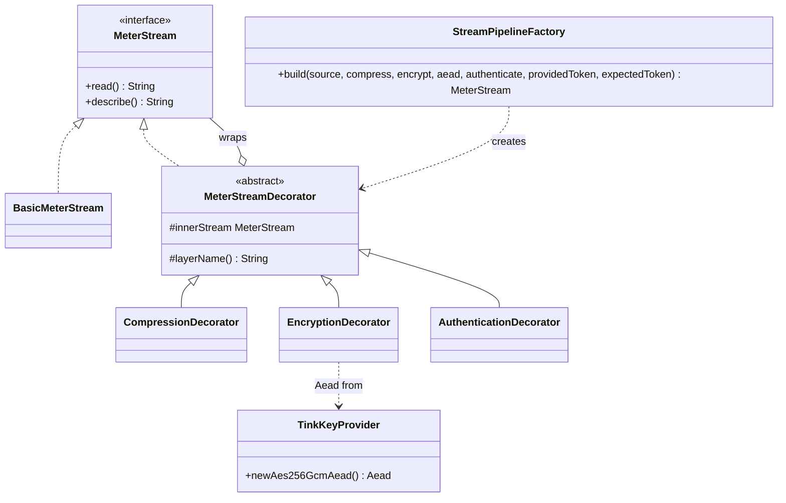
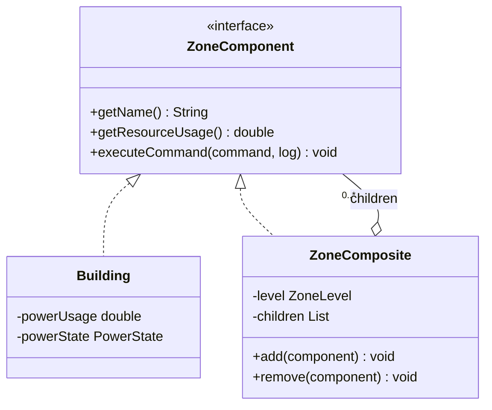
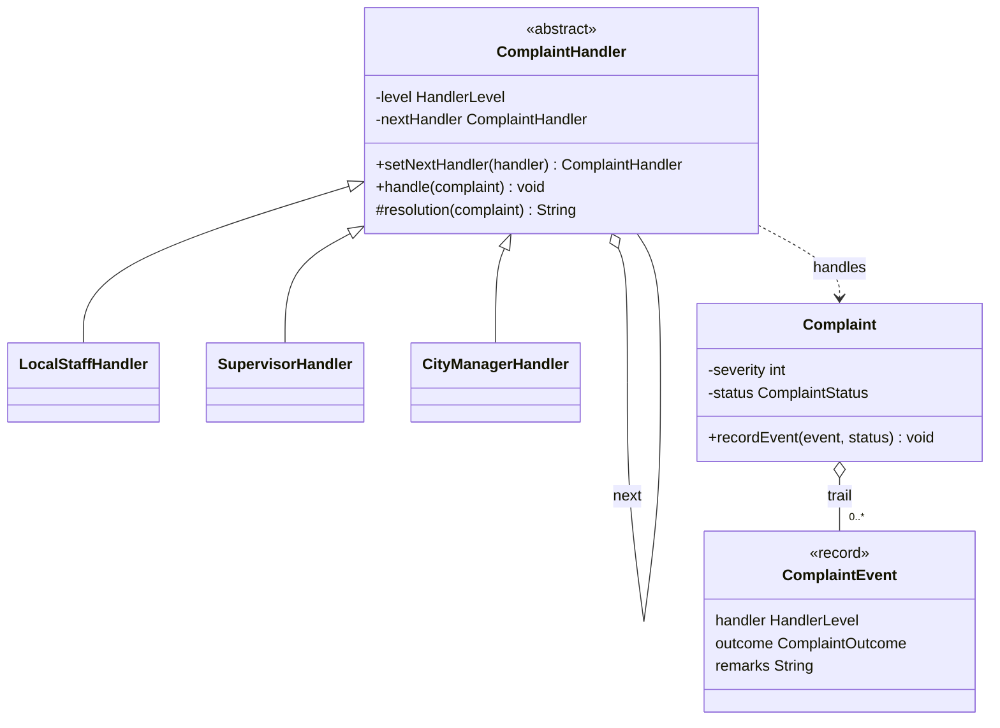
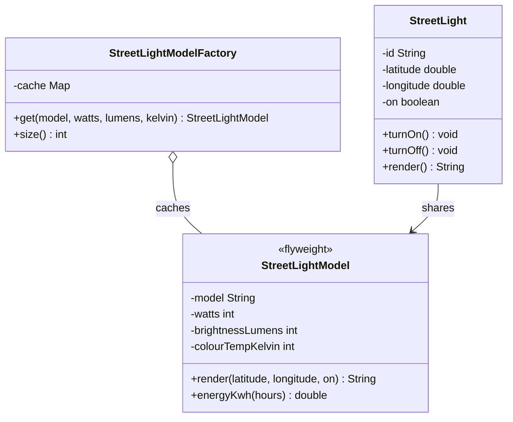
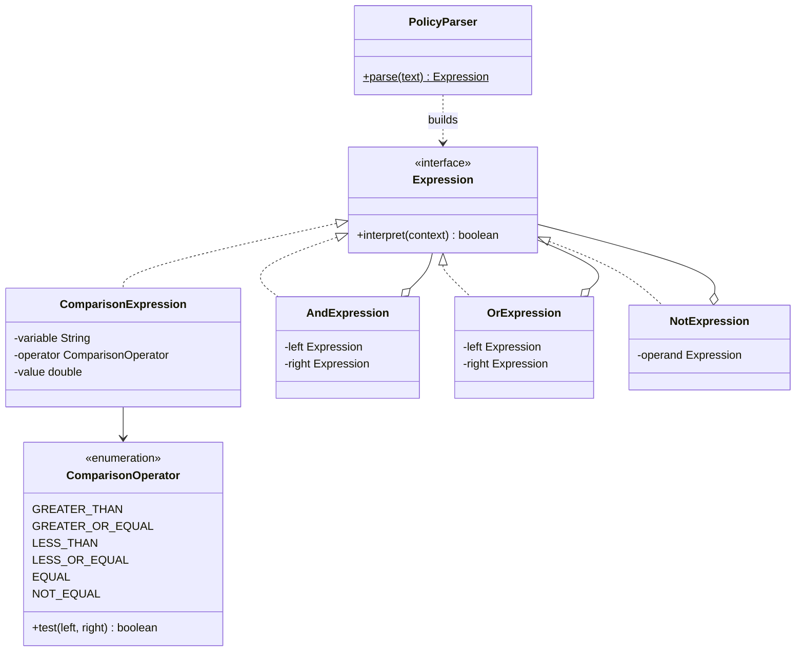

# SmartCity360

Smart City Management Platform for the fictional UrbanTech Solutions, built for the JIAT *Object Oriented Design Patterns II* assessment (JIAT/OODP II/EX/01).

Each of the five scenarios (Parts A to E) is solved with exactly one object-oriented design pattern. The backend is built first in plain Java (no framework); a web frontend is added afterwards.

## Tech stack

| Layer | Technology |
|---|---|
| Language | Java 17+ |
| Build | Maven (WAR packaging) |
| Backend | Plain Java (no framework) |
| Encryption | Google Tink (AES-256-GCM AEAD) |
| Database access | JDBC with MySQL Connector/J (planned, not used by the patterns yet) |
| Database | MySQL 8.0.16+ (planned; CHECK constraints are enforced from this version) |
| Testing | JUnit 5 |
| Web layer and frontend | To be decided after the backend (for example a small embedded HTTP server for a React frontend) |

## Patterns used

| Part | Scenario | Pattern | Package | Test class |
|---|---|---|---|---|
| A | Encryption, authentication and compression layers for energy meter streams | Decorator | `patterns/decorator` | `DecoratorPatternTest` |
| B | City → district → street → building with uniform commands | Composite | `patterns/composite` | `CompositePatternTest` |
| C | Complaint escalation: local staff → supervisor → city manager | Chain of Responsibility | `patterns/chain` | `ChainPatternTest` |
| D | Thousands of street lights with minimal memory | Flyweight | `patterns/flyweight` | `FlyweightPatternTest` |
| E | City policy rules written in a mini-language | Interpreter | `patterns/interpreter` | `InterpreterPatternTest` |

All five patterns are implemented and covered by unit tests. `Main` runs a console demonstration of all five.

## Build, test and run

```
mvn clean test       # runs the five pattern test classes
mvn clean package    # builds target/smartcity360.war
```

To see every pattern working, run `lk.menara.smartcity360.Main` from IntelliJ. It needs no database. It prints one short demonstration per part (A to E), which is also a good script for the demonstration video.

## Project structure

What is in the repository now:

```
SmartCity
├── pom.xml
├── README.md
└── src
    ├── main/java/lk/menara/smartcity360
    │   ├── Main.java                 console demo of Parts A to E
    │   ├── config/                   AppConstants (severity limits)
    │   ├── exception/                AppException and its subclasses
    │   ├── model/                    Complaint, ComplaintEvent
    │   │   └── enums/                ZoneLevel, CommandType, PowerState, HandlerLevel,
    │   │                             ComplaintStatus, ComplaintOutcome, ComparisonOperator
    │   └── patterns/                 one sub-package per pattern
    │       ├── decorator/            Part A
    │       ├── composite/            Part B
    │       ├── chain/                Part C
    │       ├── flyweight/            Part D
    │       └── interpreter/          Part E
    └── test/java/lk/menara/smartcity360/patterns/   one test class per pattern
```

Planned, not yet in the repository: `auth/` (login and sign-up, separate from Part A), `controller/`, `dto/`, `repository/` (JDBC), `service/`, `util/`, `model/entity/`, `resources/application.properties`, `resources/db/schema.sql` and `docs/` (ER diagram, UML diagrams, report).

Request flow once those layers exist: UI → controller → service → pattern / model → repository (JDBC) → MySQL.

### Enum policy

A Java enum is used only for a small, fixed set of values that the code branches on:

| Enum | Values |
|---|---|
| `ZoneLevel` | CITY, DISTRICT, STREET |
| `CommandType` | SHUTDOWN_POWER, RESTORE_POWER, REPORT_USAGE |
| `PowerState` | ON, OFF (power state of a building) |
| `HandlerLevel` | LOCAL_STAFF (severity 1 to 3), SUPERVISOR (4 to 7), CITY_MANAGER (8 to 10) |
| `ComplaintStatus` | OPEN, ESCALATED, RESOLVED, UNRESOLVED |
| `ComplaintOutcome` | HANDLED, ESCALATED, UNRESOLVED |
| `ComparisonOperator` | GREATER_THAN, GREATER_OR_EQUAL, LESS_THAN, LESS_OR_EQUAL, EQUAL, NOT_EQUAL |

Data that can grow will be a lookup table instead (`role`, `complaint_category`, `security_layer`), and other two-state flags will be booleans (`is_on`, `is_active`). When the database is added, enums are stored as text (`enum.name()` when saving, `Enum.valueOf(...)` when reading), never as ordinals.

## Design notes per part

### Part A: Decorator
`MeterStream` is the common interface (`read()` returns the stream text, `describe()` lists the layers). `BasicMeterStream` is the core, and `MeterStreamDecorator` is the abstract wrapper that holds another `MeterStream`. `CompressionDecorator`, `EncryptionDecorator` and `AuthenticationDecorator` extend it and can be stacked without changing the core. `StreamPipelineFactory.build(...)` stacks the layers a caller asks for.

- **Compression** uses `GZIPOutputStream` and Base64 (so the compressed bytes can travel as text).
- **Encryption** uses Google Tink's AES-256-GCM `Aead`, created by `TinkKeyProvider`. Tink generates a fresh nonce for every message, attaches it to the ciphertext and verifies integrity when decrypting, so a tampered or wrongly keyed message throws `StreamProcessingException`. The key is generated in memory for this assessment. In production it would be kept in a key management service (Tink supports Google Cloud KMS and AWS KMS) so it can be stored safely and rotated.
- **Authentication** checks an access token (constant-time comparison) before any data is read, and throws `AuthenticationFailedException` if it is missing or wrong. It is separate from user login (`auth/`, planned). Data integrity is handled by Tink's authenticated encryption, so the two cover different things: the token controls who may read, and AES-GCM detects tampering.

Order matters: compress first (encrypted data cannot be compressed), then encrypt, then authenticate on the outside:

```
raw data → GZIP + Base64 → AES-256-GCM (Tink) + Base64 → token check
```

To reverse it: `EncryptionDecorator.decrypt(...)` then `CompressionDecorator.decompress(...)`.



### Part B: Composite
`ZoneComponent` declares `getName()`, `getResourceUsage()` and `executeCommand(CommandType, List<String> log)`. `Building` is the leaf and `ZoneComposite` (city, district, street) holds child components. A command on any node runs on the whole branch: a composite logs the command and passes it to every child, and a building changes its `PowerState`. Usage is added up the hierarchy (a switched-off building counts as 0). A zone cannot be added to itself or to one of its own descendants.



### Part C: Chain of Responsibility
`ComplaintHandler` holds a reference to the next handler (`setNextHandler` returns that handler so a chain can be written in one line). Its `handle(complaint)` is final: the handler resolves the complaint if its `HandlerLevel` allows the severity, otherwise it records an escalation and passes the complaint on. Each subclass only supplies its `resolution(...)` text. Severity bands are in `HandlerLevel`: 1 to 3 local staff, 4 to 7 supervisor, 8 to 10 city manager. `ComplaintChainFactory.build()` links the three handlers. Every step is stored as a `ComplaintEvent` on the `Complaint`, which gives the escalation trail. If the chain ends without a handler that can take the complaint, it is marked `UNRESOLVED`.



### Part D: Flyweight
Intrinsic (shared) state is in `StreetLightModel`: model name, watts, brightness (lumens) and colour temperature (kelvin). It is immutable and its constructor is package-private, so the only way to get one is through `StreetLightModelFactory.get(...)`, which keeps one shared object per distinct set of values in a thread-safe cache. Extrinsic (unique) state is in `StreetLight`: id, position and on/off. Each light holds a reference to its shared model, and the position and on/off state are passed to the flyweight's `render(...)` only when needed. With 50,000 lights of 3 types there are 3 model objects, not 50,000 (checked in `FlyweightPatternTest`).



### Part E: Interpreter
Rules are text, parsed by `PolicyParser` into an expression tree and evaluated against a context of values (`Map<String, Double>`, for example `noise_level` and `hour`). Because the rule is data, changing a rule does not need a code change or a restart.

Example: `noise_level > 70 AND (hour >= 22 OR hour < 6)`

```
expression := term ( "OR" term )*
term       := factor ( "AND" factor )*
factor     := "NOT" factor | "(" expression ")" | VARIABLE OPERATOR NUMBER
```

- Operators: `>`, `>=`, `<`, `<=`, `==`, `!=`. Numbers may be negative or decimal.
- `NOT` binds tighter than `AND`, and `AND` tighter than `OR`. Keywords are not case sensitive.
- The parser is recursive descent (one method per grammar rule). A malformed rule throws `PolicyException` with the position of the problem. A variable missing from the context also throws `PolicyException` when the rule is evaluated.
- Every expression prints itself (`toString()`), so a parsed tree can be shown and parsed again.
- To add a new kind of rule node (for example `XOR`), add one `Expression` class and one grammar rule; the existing expressions do not change.



## Database (planned)

Not yet in the repository. The intended setup:

1. Create the schema and starting data: run `src/main/resources/db/schema.sql` in MySQL.
2. Set the connection in `src/main/resources/application.properties` (read by a class in `config/` using `java.util.Properties`):
   ```
   db.url=jdbc:mysql://localhost:3306/smartcity360
   db.username=<your user>
   db.password=<your password>
   ```
   Do not commit your real password.

| Pattern | Tables |
|---|---|
| A Decorator | `energy_meter`, `meter_reading`, `energy_stream_log`, `energy_stream_layer`, `security_layer` |
| B Composite | `zone` (self-referencing tree), `building` (leaf), `command_log` |
| C Chain of Responsibility | `complaint`, `complaint_event`, `complaint_category`, `role` |
| D Flyweight | `street_light_type` (shared), `street_light` (unique) |
| E Interpreter | `policy_rule` (`expression` holds the rule text) |
| Users | `app_user`, `role` |

`energy_stream_layer.layer_order` will record the layer order for Part A.

## Submission checklist (Part F)

- Project report (PDF) with UML class diagrams, code excerpts and justifications. Parts B and E explicitly ask for a UML class diagram; the Mermaid diagrams above can be reused.
- Complete source code as a ZIP file.
- Demonstration video (MP4, 10 to 15 minutes) showing the five patterns working (`Main` is a ready-made script).
- Be ready to explain every pattern and design choice in the VIVA.

## References

List every book, article and website used here, as the assessment requires. For example: the Gang of Four *Design Patterns* book, the Google Tink documentation and the Java `java.util.zip` documentation.
