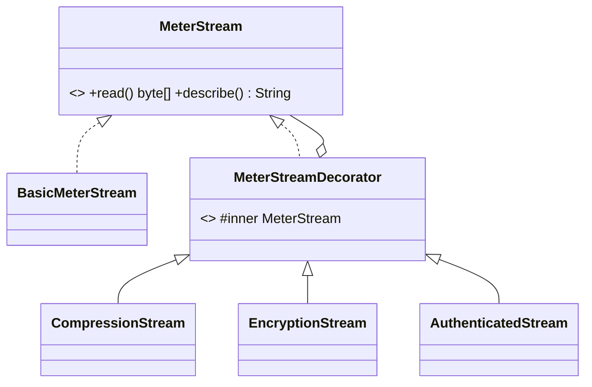
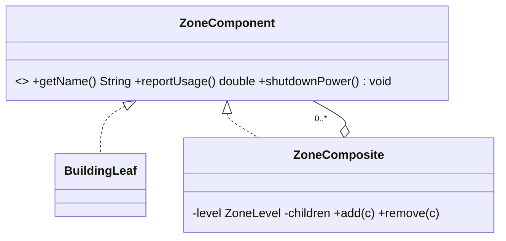
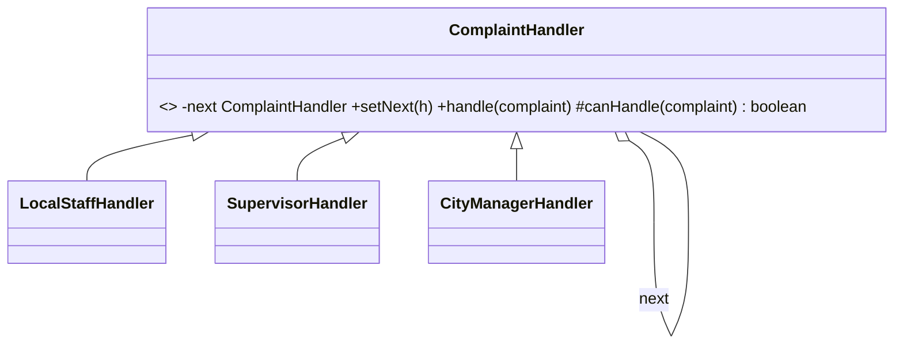
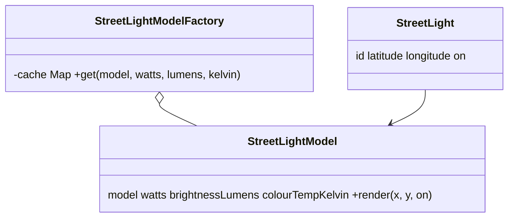
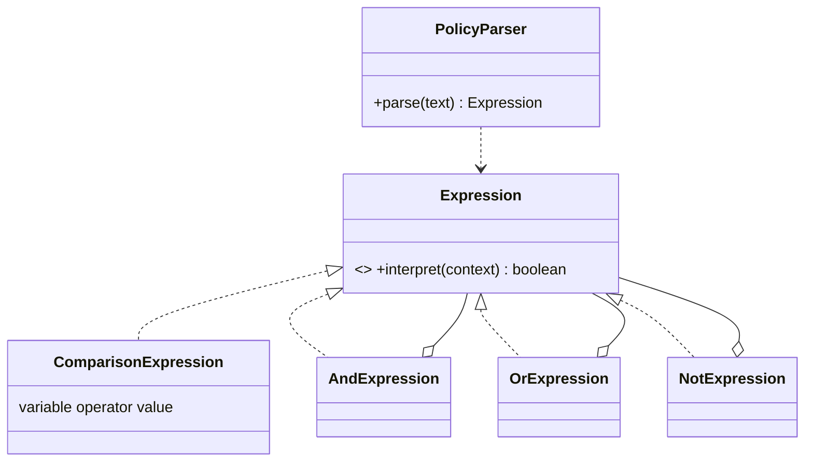

# SmartCity360

Smart City Management Platform for the fictional UrbanTech Solutions, built for the JIAT *Object Oriented Design Patterns II* assessment (JIAT/OODP II/EX/01).

Each of the five scenarios (Parts A to E) is solved with exactly one object-oriented design pattern. The backend is built first in plain Java (no framework); a web frontend is added afterwards.

## Tech stack

| Layer | Technology |
|---|---|
| Language | Java 17+ |
| Build | Maven |
| Backend | Plain Java (no framework) |
| Database access | JDBC with MySQL Connector/J |
| Database | MySQL 8.0.16+ (CHECK constraints are enforced from this version) |
| Testing | JUnit 5 |
| Web layer and frontend | To be decided after the backend (for example a small embedded HTTP server for a React frontend) |

## Patterns used

| Part | Scenario | Pattern |
|---|---|---|
| A | Encryption, authentication and compression layers for energy meter streams | Decorator |
| B | City → district → street → building with uniform commands | Composite |
| C | Complaint escalation: local staff → supervisor → city manager | Chain of Responsibility |
| D | Thousands of street lights with minimal memory | Flyweight |
| E | City policy rules written in a mini-language | Interpreter |

## Project structure

```
SmartCity
├── pom.xml
├── README.md
├── docs/                         ER diagram, UML diagrams, report
└── src
    ├── main
    │   ├── java/lk/menara/smartcity360
    │   │   ├── auth/             login and sign-up (not part of Part A)
    │   │   ├── config/
    │   │   ├── controller/       entry points for the UI/web layer, no business logic
    │   │   ├── dto/
    │   │   ├── exception/
    │   │   ├── model/
    │   │   │   ├── entity/       plain Java classes that map to the tables
    │   │   │   └── enums/        ZoneLevel, ComplaintStatus, ...
    │   │   ├── patterns/         one sub-package per pattern (A to E)
    │   │   ├── repository/       JDBC data access (one class per table)
    │   │   ├── service/
    │   │   └── util/
    │   └── resources
    │       ├── application.properties
    │       └── db/schema.sql
    └── test/java/...             one test class per pattern
```

Request flow: UI → controller → service → pattern / model → repository (JDBC) → MySQL.

## Database setup

1. Create the schema and starting data: run `src/main/resources/db/schema.sql` in MySQL.
2. Set the connection in `src/main/resources/application.properties` (read by a class in `config/` using `java.util.Properties`):
   ```
   db.url=jdbc:mysql://localhost:3306/smartcity360
   db.username=<your user>
   db.password=<your password>
   ```
   Do not commit your real password.
3. Build and run:
   ```
   mvn clean package
   ```
   Then run `lk.menara.smartcity360.Main` from IntelliJ.

### Tables and the pattern each supports

| Pattern | Tables |
|---|---|
| A Decorator | `energy_meter`, `meter_reading`, `energy_stream_log`, `energy_stream_layer`, `security_layer` |
| B Composite | `zone` (self-referencing tree), `building` (leaf), `command_log` |
| C Chain of Responsibility | `complaint`, `complaint_event`, `complaint_category`, `role` |
| D Flyweight | `street_light_type` (shared), `street_light` (unique) |
| E Interpreter | `policy_rule` |
| Users | `app_user`, `role` |

### Enum policy

A database or Java enum is used only for a small, fixed set of values that the code branches on:

| Enum | Values |
|---|---|
| `ZoneLevel` | CITY, DISTRICT, STREET |
| `CommandType` | SHUTDOWN_POWER, RESTORE_POWER, REPORT_USAGE |
| `ComplaintStatus` | OPEN, ESCALATED, RESOLVED, UNRESOLVED |
| `ComplaintOutcome` | HANDLED, ESCALATED, UNRESOLVED |

Data that can grow is a lookup table instead (`role`, `complaint_category`, `security_layer`), and two-state flags are booleans (`is_powered_on`, `is_on`, `is_active`). Enums are stored as text (`enum.name()` when saving, `Enum.valueOf(...)` when reading), never as ordinals.

## Design notes per part

### Part A: Decorator
`MeterStream` is the common interface. `BasicMeterStream` is the core, and `MeterStreamDecorator` is the abstract wrapper that holds another `MeterStream`. `CompressionStream`, `EncryptionStream` and `AuthenticatedStream` extend it and can be stacked in any order without changing the core. The order matters (compress before encrypt), so `energy_stream_layer.layer_order` records it. The authentication layer is a stream wrapper and is separate from user login (`auth/`).



### Part B: Composite
`ZoneComponent` declares `shutdownPower()` and `reportUsage()`. `BuildingLeaf` is the leaf and `ZoneComposite` (city, district, street) holds child components. A command on any node runs on the whole branch. Each run is stored in `command_log`.



### Part C: Chain of Responsibility
`ComplaintHandler` holds a reference to the next handler. Suggested severity bands (kept in the handler classes, not the database): 1 to 3 local staff, 4 to 7 supervisor, 8 to 10 city manager. Every step is written to `complaint_event`, which gives the escalation trail.



### Part D: Flyweight
Intrinsic (shared) state is in `street_light_type`: model, watts, brightness, colour temperature. Extrinsic (unique) state is in `street_light`: position and on/off. A factory caches one shared object per type.



### Part E: Interpreter
Rules are stored as text in `policy_rule.expression`, parsed into an expression tree, and evaluated against a context of values.

Example: `noise_level > 70 AND (hour >= 22 OR hour < 6)`

```
expression := term ( "OR" term )*
term       := factor ( "AND" factor )*
factor     := "NOT" factor | "(" expression ")" | VARIABLE OPERATOR NUMBER
```



## Submission checklist (Part F)

- Project report (PDF) with UML class diagrams, code excerpts and justifications.
- Complete source code as a ZIP file.
- Demonstration video (MP4, 10 to 15 minutes) showing the five patterns working.
- Be ready to explain every pattern, table and design choice in the VIVA.

## References

List every book, article and website used here, as the assessment requires.
